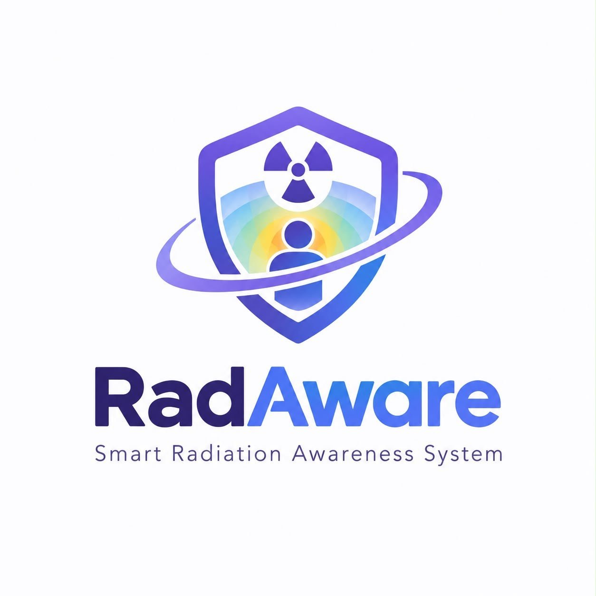

# RadAware



**Smart Radiation Awareness System**: a real-time, visual decision-support concept that turns invisible scatter radiation in the angiography room into a live heat map and tracks each team member's estimated cumulative dose.

**Team:** حَدَق  
**Event:** Medathon, Saudi Youth Healthcare Forum  
**Track:** 3. Medical Tools & Devices Innovation

### 👉 [Open the live prototype](https://ramaalshabastari.github.io/RadAware/)

> **Concept-stage prototype.** The camera and the X-ray receptor are simulated, and the dose model uses illustrative placeholder constants. RadAware does **not** measure radiation, does **not** produce validated dose values, and does **not** replace personal dosimetry (TLD/OSL), lead shielding or ALARA protocols. See [Limitations](#limitations).

---

## The problem

Staff in interventional radiology and catheterization labs work next to a dynamic X-ray scatter field that changes with C-arm geometry, patient anatomy and staff position. Traditional dosimeters (TLD/OSL) only report **after** the fact, often monthly or quarterly. During a procedure the team cannot see where the high-radiation zones are, and between readings nobody knows how close a person is to their annual limit. Hands and eyes are particularly exposed.

## Our idea

RadAware adds a live, spatial layer of awareness on top of existing protection:

1. **Before the exam:** the specialist enters the team's IDs and protective equipment (lead apron thickness, thyroid collar, lead glasses) and marks the primary operator as the position reference.
2. **During the exam:** a ceiling camera tracks where each person stands. Using the X-ray unit's exposure data, RadAware draws a colour-coded scatter heat map of the room and estimates each person's dose rate at their position, taking their protection into account. It can also suggest lower-dose positions while keeping the operator at the reference spot.
3. **After the exam:** each person's estimated dose is saved and added to their running annual total. When someone approaches their annual limit, the dashboard raises an alert so the team knows that person should have their TLD/OSL read, **even if the hospital's scheduled reading is not due yet.**

**Users:** the radiology specialist operates the system; the whole team in the angiography room benefits (physicians, nurses, technologists).

## What this prototype demonstrates

| Page | File | What it does |
|---|---|---|
| **1. Setup** | `index.html` | The specialist adds team members (name, ID, role, apron, collar, glasses) and chooses the primary operator. |
| **2. Live Room** | `camera.html` | Simulated ceiling-camera view of the room. People can be dragged around, linked to staff IDs, and the heat map and per-person dose update live. Includes dose accumulation, position suggestion, and alerts. |
| **3. Dashboard** | `dashboard.html` | Saved exams, yearly dose per person against the limits, TLD/OSL check alerts, exam history and CSV export. |

Other features: dark and light mode, responsive layout, and a "Load demo history" button on the dashboard so reviewers can see the alert flow immediately.

## Try it in 2 minutes

1. Open the [live prototype](https://ramaalshabastari.github.io/RadAware/) and click **Load demo team**, then **Save & continue**.
2. In the **Live Room**, click **Start X-ray** and watch the heat map and doses. Drag people, change the C-arm angle, and try **Suggest positions**.
3. Click **Finish & save exam**. On the **Dashboard**, click **Load demo history** to see the annual totals and the TLD/OSL alert.

## Screenshots

| Setup | Live Room | Dashboard |
|---|---|---|
|  |  |  |

## How the estimate works (simplified)

- **Inputs (simulated here):** dose-rate reading, tube potential (kVp), field size and C-arm angle. In a real deployment these would come from the imaging unit and its receptor.
- **Scatter field:** scatter dose rate falls with the inverse square of the distance from the isocentre and is weighted towards the tube side of the C-arm.
- **Personal dose:** the ambient value at each person's position is reduced by their lead apron (thickness and kVp dependent) and, for the lens of the eye, by lead glasses.
- **Annual tracking:** doses are summed per person for the calendar year and compared with the annual limits.

All constants live in one file, [`config.js`](config.js), so a medical physicist can review and calibrate them.

## Limitations

We want to be transparent about what this prototype is and is not:

- The **camera and receptor are simulated**. A web page on GitHub Pages cannot connect to an angiography unit. Real integration is future work.
- The scatter model is a **simplified, illustrative model**. The constants (scatter fraction, apron transmission, glasses factor, angular weighting) are placeholders, **not validated values**.
- **Annual limits** in `config.js` use ICRP values (20 mSv/year effective dose and lens of the eye, averaged over 5 years with a maximum of 50 mSv in any single year; 500 mSv/year for extremities). They must be confirmed against the Saudi Nuclear and Radiological Regulatory Commission regulation (NRRC-R-01) before any real use. Hand/extremity dose is not modelled yet.
- Data is stored **only in the browser** (`localStorage`). There is no server, account system or cloud storage in this version.
- Not a medical device and not approved for clinical use yet.

## Validation plan (next steps)

- Calibrate and compare estimates with dosimeter readings at defined points in the room.
- Test multiple tube angles and exposure conditions; record prediction error and update latency.
- Replace the simulated inputs with real exposure data from the imaging unit and a depth camera for position tracking (privacy-preserving, no identity recognition required).
- Add secure cloud storage with authentication and role-based access, and confirm the limits with the radiation protection office.
- Review usability with clinical staff and medical physicists.

## Privacy and safety

- The repository is public: **do not enter real staff IDs, names or dose data.** All sample data is fictional (`DEMO-001`, etc.).
- The tracking concept uses depth sensing without face or identity recognition.
- RadAware is designed as an **adjunctive** layer that complements, never replaces, personal dosimetry, shielding and ALARA.

## Initial evidence reviewed

- Real-time scattered-radiation display for fluoroscopically guided interventions: https://pmc.ncbi.nlm.nih.gov/articles/PMC10287622/
- 3D/2D display of scattered radiation distribution: https://pmc.ncbi.nlm.nih.gov/articles/PMC6049623/
- Computer-vision recognition of staff for dose-management software: https://pmc.ncbi.nlm.nih.gov/articles/PMC7963405/
- Occupational radiation exposure to the lens of the eye in interventional radiology (DOI: 10.1111/1754-9485.13307)
- Exposure of the practitioner's hands to radiation during procedures (PMC6867788)

Existing systems already address parts of this problem, so our novelty needs to be established through a structured comparison, which is part of our next steps.

## Technology

Plain HTML, CSS and JavaScript (no frameworks, no server), hosted on GitHub Pages.

```
RadAware/
├── index.html       Setup page
├── camera.html      Live Room page
├── dashboard.html   Dashboard page
├── style.css        Shared styles (dark/light themes)
├── app.js           Shared helpers (storage, theme)
├── config.js        Limits and model constants (to be calibrated)
└── logo.png.jpg     Logo
```

## Development note

This prototype was built by a team of beginners with **AI assistance**.
